# Müzik Sepeti — Database ER Diagram

> Version 1.0 — Phase 0 deliverable. Full Prisma schema is implemented in `apps/backend/prisma/schema.prisma`.

## 1. Entity-Relationship Overview

```mermaid
erDiagram
    USERS ||--o{ USER_FAVORITES : has
    USERS ||--o{ USER_COLLECTIONS : has
    USERS ||--o{ USER_ACTIVITY_EVENTS : generates
    USERS ||--o{ USER_TUNING_PRESETS : owns
    USERS ||--o{ RECORDINGS : creates

    MUSIC_GENRES ||--o{ SONGS : contains

    SONGS ||--o{ SONG_ALIASES : has
    SONGS ||--o{ SONG_LYRICS : has
    SONGS ||--o{ SONG_VERSES : partOf
    SONGS ||--o{ SONG_METADATA : has
    SONGS ||--o{ SONG_STORIES : has
    SONGS ||--o{ SONG_SOURCES : has
    SONGS ||--o{ SONG_NOTATIONS : has
    SONGS ||--o{ SONG_CHORDS : has
    SONGS ||--o{ SONG_TABS : has
    SONGS ||--o{ SONG_REGIONS : associatedWith
    SONGS ||--o{ SONG_VIDEO_SEARCHES : has
    SONGS ||--o{ SONG_ARTISTS : has
    SONGS ||--o{ SONG_COMPOSERS : has
    SONGS ||--o{ RECORDINGS : linkedTo
    SONGS ||--o{ USER_ACTIVITY_EVENTS : receives
    SONGS ||--o{ TRENDING_SCORES : scores

    REGIONS ||--o{ SONG_REGIONS : lists
    REGIONS ||--o{ PROVINCES : contains
    PROVINCES ||--o{ DISTRICTS : contains

    INSTRUMENTS ||--o{ INSTRUMENT_TYPES : has
    INSTRUMENT_TYPES ||--o{ TUNING_CONFIGS : configuredFor
    TUNING_SYSTEMS ||--o{ TUNING_CONFIGS : defines
    TUNING_CONFIGS ||--o{ TUNING_STRINGS : lists
    TUNING_CONFIGS ||--o{ USER_TUNING_PRESETS : copiedFrom

    RHYTHMS ||--o{ SONG_METADATA : defines
    MAKAMS ||--o{ SONG_METADATA : defines
    SONG_VIDEO_SEARCHES ||--o{ VIDEO_PROVIDERS : uses

    CONTENT_LICENSES ||--o{ SONGS : licenses
    CONTENT_LICENSES ||--o{ SONG_SOURCES : references
    USER_COLLECTIONS ||--o{ COLLECTION_ITEMS : contains
    SONGS ||--o{ COLLECTION_ITEMS : includedIn
```

## 2. Entity Catalog

### Core Music Domain

| Entity | Purpose | Key fields |
|---|---|---|
| `MusicGenres` | Dynamic genre registry (starts with Turkish Folk Music) | name, slug, code, order, isActive |
| `Songs` | The central song record | title, regionId, category, status, verified, publishedAt, licenseId |
| `SongAliases` | Alternative titles / regional variants | songId, alias, isPrimary, note |
| `SongLyrics` | One or more lyric versions per song | songId, versionName, language, source, copyrightNote, isPrimary |
| `SongVerses` | Ordered verses/chorus units | lyricsId, orderIndex, type (verse/chorus), text |
| `SongMetadata` | Musical metadata (nullable, genre-aware via JSON) | songId, rhythmId, timeSignature, makamId, scale, tempo, rawJson |
| `SongRegions` | Song ↔ Region many-to-many (multiple origins, disputed allowed) | songId, regionId, provinceId, districtId, confidence, disputed |
| `SongStories` | Historical/cultural background | songId, content, verifiedFacts, oralTradition, sourcesJson |
| `SongSources` | Provenance: compiler (derleyen), source person (kaynak kişi) | songId, type, name, detail, url |
| `SongNotations` | Notation images/vectors; future MusicXML/MIDI | songId, format, fileUrl, mime, resolution, isVerified |
| `SongChords` | Chord-over-lyrics entries | songId, lyricsId, chordSeqJson, format, isVerified |
| `SongTabs` | Tablature entries | songId, instrumentId, tabText, format |
| `Artists` / `Composers` | People registry | name, bio, birthYear, regionId, isVerified |
| `SongArtists` / `SongComposers` | Many-to-many role links | songId, personId, role, orderIndex |

### Geography (independent module)

| Entity | Purpose |
|---|---|
| `Regions` (7 TR regions) | name, code, countryCode — extensible to other countries |
| `Provinces` | regionId, name, plateCode |
| `Districts` | provinceId, name |

### Instruments & Tuning

| Entity | Purpose |
|---|---|
| `Instruments` | Bağlama, Guitar, Cello, Ukulele… (dynamic) |
| `InstrumentTypes` | Short-neck / long-neck bağlama etc. | 
| `TuningSystems` | Bağlama Düzeni, Kara Düzen… (dynamic, per instrument) |
| `TuningConfigurations` | Name, instrumentTypeId, tuningSystemId, stringCount, notes, octaves, frequencies, referenceSource, editable, isOfficial |
| `TuningStrings` | Per-string rows: orderIndex, note, octave, targetHz, stringGroup |
| `UserTuningPresets` | User-saved custom tunings (snapshot of config + overrides) |
| `Rhythms` | Usûl definitions: name, timeSignature, subdivisions, accentPattern; TR presets (Düyek, Sofyan, Aksak…) |

### Video & Content Management

| Entity | Purpose |
|---|---|
| `VideoProviders` | YouTube + future providers registry |
| `SongVideoSearches` | Generated search queries (title+solfej, title+nota…), results cache, providerId |
| `ContentLicenses` | License records: type (public-domain/licensed/user), owner, terms, expiry |
| `ContentChangeLogs` | Audit trail for every important content change |

### Users & Engagement

| Entity | Purpose |
|---|---|
| `Users` | name, email, phone, passwordHash, providers (google/apple), roles |
| `RefreshTokens` | JWT refresh token storage (hashed) |
| `UserFavorites` | songId + userId unique |
| `UserCollections` | name, isPublic, coverArt |
| `CollectionItems` | collectionId, songId, position |
| `UserActivityEvents` | songId, userId/sessionId, eventType, timestamp, deviceInfo |
| `UserPreferences` | theme, language, fontScale, contentFilters |
| `TrendingScores` | songId, periodStart (7-day rolling), score, rankSnapshot |
| `Recordings` | local-first recordings metadata (fileName, duration, instrumentId, songId, sizeBytes) — files stay on device; cloud backup flag for premium |

## 3. Design Rules

- **Normalization target**: 3NF for core metadata; permissive `Json` fields only for genuinely flexible music attributes (e.g., scale details) — never for searchable data.
- **Constraints**: unique indexes on `(Users.email)`, `(UserFavorites.songId, userId)`, `(MusicGenres.slug)`, `(TuningConfigurations.name, instrumentTypeId)` etc.; FK cascade rules chosen per relationship (e.g., lyrics delete cascades verses; songs soft-archive, never hard-delete).
- **Soft delete**: `deletedAt` on Songs and content rows; admin uses archive.
- **Content status enum**: `DRAFT | REVIEW | APPROVED | PUBLISHED | REJECTED | ARCHIVED`.
- **Unicode**: all text columns `utf8mb4`-safe through Prisma default; Turkish-aware search normalization implemented at application layer (see 04-api-endpoints.md §Search).
- **Backup**: pg_dump scheduled; object storage versioning for uploaded assets.

## 4. Schema File Location

The complete, guaranteed-consistent Prisma schema is generated during Phase 1 implementation and lives at `apps/backend/prisma/schema.prisma` (this doc summarizes the design).
