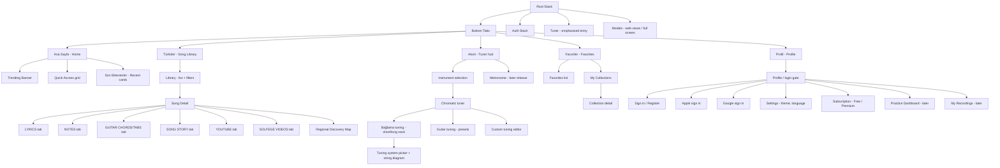

# Müzik Sepeti — Mobile Application Screen Map

> Version 1.0 — Phase 0 deliverable. Implemented skeleton lives in `apps/mobile` (Expo Router).

## 1. Navigation Structure (Expo Router)

## 2. Bottom Navigation (Primary)

| Tab | Label (TR) | Route | Purpose |
|---|---|---|---|
| 1 | Ana Sayfa | `/(tabs)/` | Trending, search, quick access, recent additions |
| 2 | Türküler | `/(tabs)/kutuphane` | Filterable song library (Türkü Kütüphanesi) |
| 3 | Akort | `/(tabs)/akort` | Tuner hub — **visually emphasized** (central, accent-colored) |
| 4 | Favoriler | `/(tabs)/favoriler` | Favorites & collections |
| 5 | Profil | `/(tabs)/profil` | Account, settings, subscription, premium |

## 3. Home Screen Sections

### A. Trending Songs Banner
- Horizontal carousel of top 10 trending songs (rolling 7 days).
- Card: title, artist when available, region, rank badge, popularity meter.
- Source: `GET /v1/trending/songs` (Redis-cached, updated by cron).

### B. Search
- Full-screen search overlay; debounced queries; Turkish normalization (ı/i, ş/s, ç/c, ö/o, ü/u, ğ/g).
- Searchable fields: title, lyrics, artist, composer, region, instrument, genre.
- Result grouping: Songs / Artists / Regions / Collections; suggestions from Redis.

### C. Quick Access
Shortcuts: Türkü Kütüphanesi · Akort Et · Enstrümanlar · Favorilerim · Son Eklenenler · En Çok Dinlenenler/Görüntülenenler.

### D. Recently Added Songs
- Cover-card grid (aspect-ratio cards) fed by `GET /v1/songs?sort=newest&limit=12`.

## 4. Song Detail Tabs

| Tab | Content source |
|---|---|
| LYRICS | `GET /v1/songs/:id/lyrics` — verses/chorus separated, font-size control, favorite action |
| NOTES | `GET /v1/songs/:id/notations` — hi-res images, pinch-zoom, full-screen; model ready for MusicXML/MIDI |
| GUITAR CHORDS & TABS | chord-over-lyrics, chord diagrams, transpose control, tab text; extensible to bağlama tablature |
| SONG STORY | verified facts vs oral tradition clearly separated, sources listed |
| YOUTUBE | in-app search results via `GET /v1/songs/:id/videos?type=video` |
| SOLFEGE VIDEOS | `GET /v1/songs/:id/videos?type=solfege` — provider-parameterized queries |

## 5. Onboarding & Permissions Flow

1. First launch → welcome + permission explanations (mic, notifications later).
2. Microphone permission: contextual request **inside the tuner first use** (never at app start), with "why we need it" copy and settings fallback.
3. Guest mode: browsing + basic tuner available with no account.

## 6. Theme & Typography (Design System)

| Token | Dark | Light (mapped) | Usage |
|---|---|---|---|
| bg-primary | `#121417` | `#F7F5F1` | App background |
| bg-secondary | `#20252B` | `#EDEAE3` | Cards, surfaces |
| accent-primary | `#D6A45B` | `#B07E2E` | CTAs, active tab, tuner needle |
| accent-secondary | `#3ABFA3` | `#1E9B82` | Success, in-tune state |
| text-primary | `#F5F2EC` | `#1A1C1F` | Headings & body |
| text-secondary | `#A8ADB5` | `#5F656D` | Captions, metadata |

- Type scale: 12/14/16/20/28/36; font: system font stack with Turkish glyph coverage.
- Motion: Reanimated for tab transitions, tuner needle (spring physics), card entrance animations.
- Icon set: consistent line icons (Lucide-compatible set) sized 20–28 pt.

## 7. Screen Map Conventions

- Routes are grouped per module folder; each feature (lyrics, chords, tuner…) is a self-contained screen set so future genres/instruments plug in without navigation rewrites.
- Deep links planned for song detail (`muziksepeti://song/[id]`).
