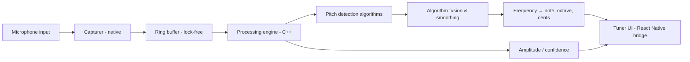

# Müzik Sepeti — Native Tuner Technical Architecture

> Version 1.0 — Phase 0 deliverable. This is **not** a simulation: the tuner performs real-time native audio capture and DSP on-device, offline.

## 1. Design Goals

- Detect fundamental frequency with accuracy ≤ ±1 cent in the range 30 Hz – 2 kHz (covers bass and violin).
- Low latency: note update every ~40–60 ms; needle motion with spring smoothing.
- Works fully offline, on-device, no backend involved.
- Robust across instruments: plucked (bağlama, guitar, ukulele), bowed (violin, cello) and mixed signals.

## 2. Audio Pipeline

**Platform capture:**

| Platform | Stack | Notes |
|---|---|---|
| iOS | AVAudioEngine / AudioUnit remote IO, Swift | 44.1 kHz mono input, `AVAudioSessionCategoryRecord` or playAndRecord with `measurement` option |
| Android | Oboe / AAudio (low-latency API) | `PerformanceMode::LowLatency`, `SharingMode::Exclusive` fallback shared; min buffer size query |
| Shared DSP | C++ (NDK / XCFramework) | Single codebase for pitch algorithms, platform-agnostic |

## 3. Pitch Detection Strategy (multi-algorithm, not a naive FFT peak)

| Algorithm | Strengths | Use case |
|---|---|---|
| **YIN** | Robust to noisy/short signals, low error on monophonic plucked strings | Primary detector for bağlama/guitar plucked transients |
| **Autocorrelation (ACF)** (normalized + parabolic interpolation) | Cheap, stable on sustained tones | Secondary/fallback; confirmation path |
| **FFT spectral (HPS / McLeod-style or CQT-lite)** | Good for very low fundamentals, harmonic-rich signals | Low-frequency support (bass/cello), octave-error correction |

**Fusion logic:** run YIN + ACF in parallel on the same frame; if they agree within tolerance → high confidence. If they diverge → re-check with FFT harmonic structure; pick the candidate with higher harmonic-support evidence and lower octave-error likelihoodvoice. Reject candidates below the amplitude gate and above the noise floor.

**Harmonic rejection:** compute spectral flatness + strength of 2×/3× of the candidate; if an integer-multiple harmonic dominates, correct the octave (a classic single-FFT failure mode).

**Stability gate:** a note is only displayed after N consecutive frames (configurable, default 3) agree within ±5 cents; hysteresis prevents flicker between adjacent semitones.

**Confidence:** normalized autocorrelation peak value × spectral clarity → 0–100% meter shown in UI.

## 4. Note → Cents Computation

- Reference: A4 = 440 Hz (user-adjustable 415–470 Hz calibration).
- `midi = 69 + 12 * log2(f / 440)`
- `cents = round((midi - round(midi)) * 100)`
- Status: `|cents| ≤ 5` → **In tune**; `< -5` → **Flat (Too low)**; `> +5` → **Sharp (Too high)**.
- Display: note name (C–B), octave, detected Hz, target Hz, deviation cents, animated needle, status pill.

## 5. Native ↔ JS Bridge (RN)

| Interface | Direction | Data |
|---|---|---|
| `startTuning(instrumentTypeId, config)` | JS → native | Capture session config |
| `onPitchSample(pitch)` | native → JS | `{ frequencyHz, note, octave, cents, confidence, amplitude }` |
| `onStatus(status)` | native → JS | running/stopped/mic-error/permission-denied |
| `stopTuning()` | JS → native | Clean shutdown |

- Events batched via emitters with timestamped samples; JS side applies spring-based needle animation (Reanimated) — no frame drops.
- No waveform crosses the bridge except as needed for visualization (downsampled, optional).

## 6. Latency & Resource Budget

- Capture callback 10–20 ms (Oboe low-latency) / 5.8 ms (iOS 44.1 kHz). DSP processed in-callback (or dedicated realtime thread) — guaranteed no allocations in the audio thread.
- UI update cadence throttled to ~20 Hz to save battery.
- Expected CPU: < 8% on mid-range devices while tuning.

## 7. Microphone Permissions & Errors

- Permission requested in context (first tuner use) with explanation + settings deep-link fallback.
- Error taxonomy surfaced in UI: `PERMISSION_DENIED`, `MIC_BUSY`, `LOW_SAMPLERATE`, `NO_INPUT`, `UNKNOWN`.
- Recordings/tuner never upload audio anywhere; mic data stays on device.

## 8. Instrument & Tuning Configuration Wiring

- Tuner core is **generic**: it receives a target tuning (list of strings: note, octave, targetHz) from `TuningConfiguration` records (database → cached → mobile).
- Instrument selection is data-driven: choosing *Bağlama → short neck* loads its tuning-systems; choosing *Guitar* loads standard/drop-D/… presets (see 07-baglama-tuning-model.md).
- The audible "sounded string" workflow: user taps a string in the visual diagram → tuner locks to that string's target → needle shows deviation for that string only.

## 9. Testing Plan (tuner-specific)

- Unit: DSP algorithms against synthetic signals (sine, harmonics, noise-injected, plucked decays, detuned by known cents).
- Integration: golden test set of real recordings (bağlama short/long neck, guitar, violin) with known ground-truth frequencies.
- Device: physical testing matrix (mid-range Android, flagships, iPhones with different sample rates).
- CI: DSP unit tests run headless (C++ test runner); RN bridge tests via Jest mocks.
