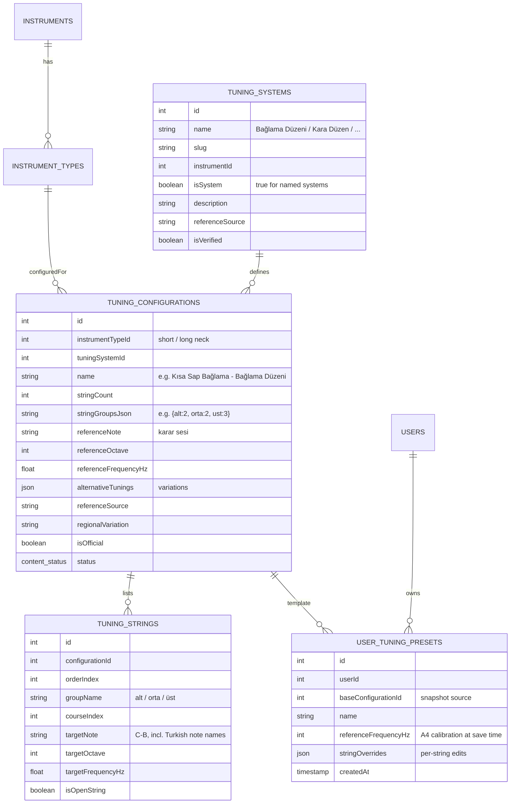

# Müzik Sepeti — Bağlama Tuning Configuration Model

> Version 1.0 — Phase 0 deliverable.
> **Data-integrity policy:** the application never hardcodes tuning frequencies. Every tuning configuration is a database record carrying a reference source and verification statusinates, exactly as required ("Do not assume that every tuning system has one universal frequency configuration"). Values below marked *"verify before seed"* must be confirmed against published method books / TRT documentation before entering production seed data; the schema supports corrections without code changes.

## 1. Domain Primer (bağlama)

- Bağlama has **three string groups (courses)**: *alt* (bottom/bass), *orta* (middle), *üst* (top, closest to the player).
- Typical string counts: alt 2, orta 2, üst 3 (most common "7 telli"); 2/2/2 variants also exist — the model stores the count per course.
- **Short-neck (kısa sap)** and **long-neck (uzun sap)** have different scale lengths → the same tuning *name* maps to different absolute pitch registrations (octave placement). They are therefore **separate TuningConfiguration records**.
- Named systems (Bağlama Düzeni, Kara Düzen, Bozlak, Misket, Abdal, Müstezat…) describe relative interval structures; actual absolute frequencies vary by region, repertoire and performance practice.

## 2. Entity Model (Prisma)



## 3. Field Semantics

| Field | Semantics |
|---|---|
| `instrumentTypeId` | Separates short-neck vs long-neck bağlama; the reason identical system names need distinct configs |
| `stringGroupsJson` | Course composition, e.g. `{"alt":2,"orta":2,"ust":3}` — supports regional 2+2+2 variants |
| `referenceNote/Octave/Frequency` | The tuning's karar (tonic) anchor, e.g. A / octave / 110 Hz for long-neck standard |
| `alternativeTunings` | JSON array of documented alternatives with notes (e.g. capo/carar variants) |
| `referenceSource` | Book/TRT archive/field research citation; required for official configs |
| `regionalVariation` | e.g. "Doğu Anadolu kara düzen varyantı" |
| `isOfficial` | True only when verified by editorial team with source |
| `status` | Reuses content workflow (DRAFT/REVIEW/APPROVED/PUBLISHED/ARCHIVED) |

## 4. Example Records (structural — *verify before seed*)

> These illustrate the model. The commonly documented standard ("Bağlama Düzeni") course relationship is tonic A – fourth D – fourth G; octave registration differs short vs long neck. All values *must* be verified against reference sources before seeding; do not treat this table as authoritative data.

| Configuration (example) | Instrument type | Alt (bass) | Orta (middle) | Üst (top) | Status |
|---|---|---|---|---|---|
| Bağlama Düzeni — uzun sap | Long-neck | A2 (110 Hz) | D3 (146.83 Hz) | G3 (196 Hz) | *verify* |
| Bağlama Düzeni — kısa sap | Short-neck | A3 (220 Hz) | D4 (293.66 Hz) | G4 (392 Hz) | *verify* |
| Kara Düzen — kısa sap | Short-neck | A3 (220 Hz) | G3 (196 Hz) | D4 (293.66 Hz) | *verify* |
| Bozlak / Misket / Abdal / Müstezat düzenleri | Both (per system) | *to be defined from sources* | | | *verify* |

(Target frequencies above are computed from the indicated note+octave at A4=440; they are illustrative of octave registration differences, not asserted facts. The seed pipeline will only insert rows whose `referenceSource` has been confirmed.)

## 5. Custom & User-Defined Tuning

1. User starts from any published config or blank slate.
2. Per-string editor: pick note+octave (derived from A4 calibration), see computed Hz, or type Hz directly; course grouping preserved.
3. Save → `UserTuningPreset` snapshot (`baseConfigurationId` optional, `stringOverrides`, calibration at save time).
4. Presets sync to the backend for authenticated users; guest presets stored locally (SQLite).

## 6. Frequency Derivation (shared util in `packages/shared/tuner`)

```
f(note, octave, a4) = a4 * 2^((midi(note,octave) - 69)/12)
```
- `a4` defaults 440 Hz, adjustable 415–470 Hz (user calibration).
- The tuner uses the config's target frequencies; a user calibration shifts all targets by the same ratio (not per-string edits — those are presets).

## 7. Extensibility (per ADR-02 / §20 of the master prompt)

- Guitar, violin, ukulele etc. need no code changes: they receive their own `TuningSystem` + `TuningConfiguration` rows (e.g. Guitar/E2–A2–D3–G3–B3–E4, Drop D, Half/Whole Step Down, Open G, Open D — seeded as separate configs with sources).
- New genres/instruments = new records; the tuner core and UI remain generic.
- Tablature module later consumes `groupName`/`courseIndex` to map strings to fret diagrams.

## 8. Governance

- Official configs: admin CRUD (workflow + audit log), sources mandatory.
- Community configs: user-submitted → moderation queue → editor verification.
- Any edit to a published config creates a revision and requires re-approval (content versioning).
