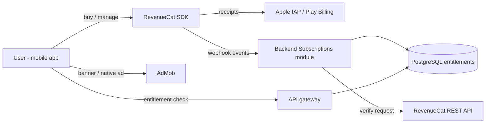

# Müzik Sepeti — Subscription & Advertising Architecture

> Version 1.0 — Phase 0 deliverable. Business model: Freemium (free+ads, premium monthly, premium annual, future tiers).

## 1. Principles

- **Tuner stays free** — no ads during active tuner, recording, or other critical real-time audio functions (hard rule).
- Premium entitlements are **verified by the backend**; the client never trusts local flags alone.
- RevenueCat is the **source of truth** for purchases (cross-platform; wraps Apple IAP + Google Play Billing).
- AdMob serves ads on the free tier at non-intrusive placements.

## 2. Architecture

## 3. Entities

| Entity | Purpose |
|---|---|
| `SubscriptionPlans` (admin-managed) | code, name, tier (FREE/PREMIUM_MONTHLY/PREMIUM_ANNUAL), price, currency, rcatProductId, isActive |
| `UserEntitlements` | userId, planId, status (ACTIVE/GRACE/EXPIRED), startsAt, expiresAt, source (revenuecat), rawPayload |
| `AdPlacementConfig` (admin-managed) | placement key (home_banner, song_detail, list_native…), adNetwork, unitId, enabled, frequencyCaps |
| `EntitlementEvents` | webhook audit: eventType, userId, rcatEvent, timestamp |

## 4. Flow: Purchase & Verification

1. Mobile loads offerings from RevenueCat (`GetOfferings`) → prices in locale.
2. User purchases → RevenueCat SDK completes store transaction.
3. RevenueCat **webhook** → `POST /subscriptions/webhook/revenuecat` (signature-verified, HMAC from RevenueCat dashboard secret).
4. Backend maps webhook event to user (by appUserID / RC anonymous ID linked at login), upserts `UserEntitlements`, records audit event.
5. App calls `GET /subscriptions/status` → backend cross-checks with RevenueCat REST when cached entitlement is near expiry/stale; returns authoritative `{ isPremium, plan, expiresAt }`.
6. Premium gates (notation downloads, offline packs, cloud recording backup, practice analytics, no-ads) evaluate this endpoint, cached 60 s with invalidation on webhook.

## 5. Entitlement Enforcement Points

| Feature | Free | Premium |
|---|---|---|
| Browse/search/lyrics/stories | ✓ | ✓ |
| Chromatic + instrument tuners | ✓ (no ads during use) | ✓ |
| Metronome, rhythm presets | basic | full presets |
| Notation (hi-res) | low-res preview | full download |
| Chords/tabs transpose | limited | unlimited |
| Offline song packs | — | ✓ |
| Recording studio | limited count/size | unlimited + cloud backup |
| Practice dashboard | 7-day view | full history + goals |
| Ads | ✓ (non-audio placements) | none |

(Exact entitlements are config-driven via plan feature flags; final mapping confirmed in product review.)

## 6. Advertising Design

- Networks: **Google AdMob** (banner, interstitial, native) — iOS + Android via Expo/RN AdMob bridge.
- Placements: home (native card), song detail footer (banner), library list (native in-stream), search results (banner), admin-selectable thanks to `AdPlacementConfig` DB table.
- Frequency caps and cooldown after any tuner/recording session; interstitial only between non-critical transitions and never during audio tasks.
- GDPR/TKVK (KVKK) consent flow via Google UMP (User Messaging Platform) before personalized ads; region-aware.

## 7. Future Pricing Flexibility

- Plans stored DB-side; promotions modeled as `Promotions` (code, discount, period) evaluated at offering-build time.
- New tiers (e.g., "Premium Family", "Lifetime") require only new plan rows + entitlement checks.
- RevenueCat experiment/AB testing hooks preserved.

## 8. Compliance Notes

- Apple/Google receipt validation handled by RevenueCat (responsible party); backend additionally verifies webhook signatures.
- No advertisements overlay the tuner/metronome/recorder screens (explicit product requirement — enforced in code at the navigation level).
- KVKK/GDPR: consent stored, ad personalization opt-in, analytics anonymized.
